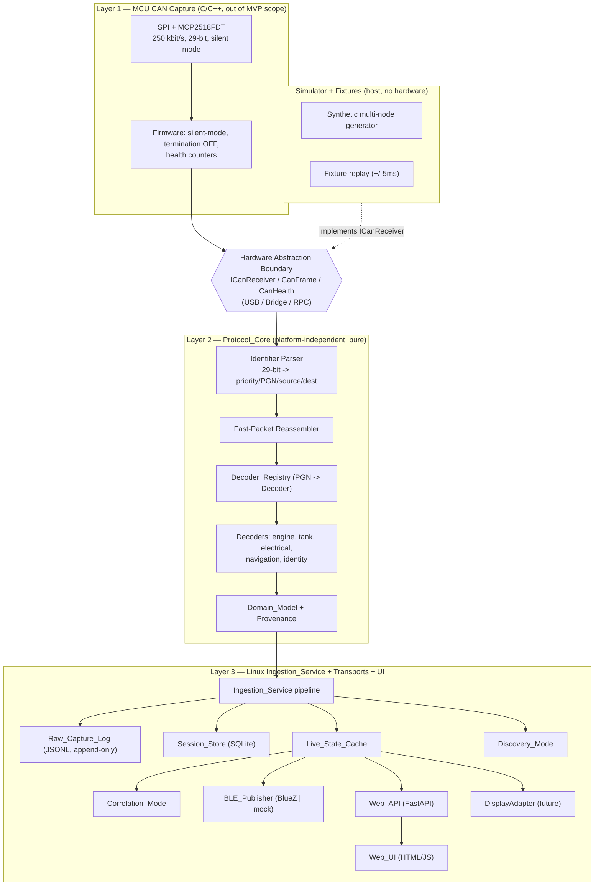
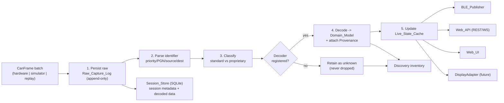

# Design Document

## Overview

The NMEA 2000 Diagnostic Platform is a passive, receive-only marine network diagnostic and discovery tool. It captures raw NMEA 2000 (CAN) traffic, decodes standard and vendor-specific messages where decoders exist, preserves everything it cannot yet interpret, and exposes a single shared Domain_Model over BLE, REST, and WebSocket, plus a local web UI.

This design leads with two non-negotiable priorities, in order:

1. **Passive receive-only safety (Requirement 1).** The MVP never transmits on the CAN bus. There is no transmit code path in the host stack. On hardware, the CAN controller/transceiver is configured for silent/listen-only mode with termination off, and the transmit path is held high-impedance through startup, shutdown, crash, and reboot. Enabling transmit is gated behind four independent barriers (separate approved spec, compile-time flag, runtime flag, explicit user action) and is out of scope here.
2. **Capture-first, classify-second (Requirement 3).** Every valid frame is persisted to the append-only Raw_Capture_Log *before* any decode, filter, or classification. No frame is dropped by manufacturer, source address, PGN, or frequency. Unknown and proprietary PGNs are retained, visible, loggable, exportable, and replayable forever.

Everything else in the platform is subordinate to those two guarantees.

### Design Goals

- **Host-testable MVP with no hardware.** The entire Layer 2/3 stack (Protocol_Core, Ingestion_Service, decoders, Simulator, mock BLE, Web_API, Web_UI) runs and is verified on macOS and Windows/Linux with no CAN hardware, no Bluetooth radio, and no vessel (Requirements 17, 23). MCU firmware (Layer 1) is described at the interface level only.
- **One Domain_Model, many transports.** Domain modules never depend on transport modules; BLE, REST, WS, and future displays consume identical values (Requirements 6, 18, 21.2).
- **Provenance on every value.** No number is ever exposed without its origin (Requirement 11).
- **Robust under hostile input.** A single corrupt frame, a malicious replay file, or an abusive client never takes the tool down (Requirements 2, 20).
- **Deterministic, testable protocol core.** Identifier parsing and fast-packet reassembly are pure functions with property-based tests (Requirement 4).

### Technology Decisions (locked)

| Concern | Choice | Rationale |
| --- | --- | --- |
| Host stack language | Python 3.11+ | One language across Protocol_Core, Ingestion, decoders, Simulator, BLE publisher, Web_API; strong host testability |
| Web UI | Plain HTML + vanilla JS, no build step | Requirement 15.1; self-contained, offline after load |
| API framework | FastAPI + Uvicorn, Pydantic models | Auto OpenAPI feeds docs/api.md; native WebSocket; validation for free |
| BLE (real) | BlueZ via **PyGObject (`gi.repository.Gio`/GDBus)**, locked 2026-10-02 | Linux GATT peripheral, run as a SEPARATE process on the board's host OS (`ble/bluez_publisher.py`) -- the App Lab container has no D-Bus/BlueZ access, confirmed via an actual UNO Q spike. The `BLE_Publisher` abstraction (`BlueZPublisher` wraps `MockBLEPublisher`) made this swap-in cheap, as designed. |
| BLE (host) | In-memory mock behind `BLE_Publisher` | No radio needed; runs on every OS |
| Session_Store | SQLite | Single-file, zero-admin, cross-platform |
| Raw_Capture_Log | Append-only JSONL + rotation | Simple, replayable, human-inspectable |
| MCU firmware | STM32/Arduino C/C++ | Interface-level only in MVP; Phase 1 bench validation |

**BLE library choice, locked 2026-10-02** (Stage 10.3 spike, run on the actual UNO Q):
`PyGObject`'s `Gio.DBusConnection` (GDBus), not `python-dbus` or `bluezero`. Found live
that `python3-gi` is already installed on the board's Debian image and reaches
`org.bluez` immediately, while `python3-dbus` needs an `apt-get install` the deploy
account has no passwordless sudo for -- GDBus is an equally standard BlueZ
GATT-peripheral implementation (BlueZ's own upstream examples exist in both flavors),
so this avoided a real deploy blocker for zero capability cost.

**Deployment-topology finding from the same spike:** the Arduino App Lab Python
container has NO access to the host's D-Bus system bus or BlueZ (`app-compose.yaml`
mounts no dbus socket; confirmed independently via Arduino's own forum and an open,
unmerged PR `arduino/arduino-app-cli#547`). A real GATT peripheral therefore cannot run
inside the same container as `web/main.py`. `ble/bluez_publisher.py` runs as a
**separate process directly on the board's Linux host**, polling the containerized
Web_API's `/api/v1/live` + `/api/v1/health` over `127.0.0.1` (Docker's port-publish
makes the container's port reachable there) and republishing into the real GATT
peripheral. Because everything above the `BLE_Publisher` boundary (and `BlueZPublisher`
itself, which wraps `MockBLEPublisher` for all state/encoding/pairing/staleness logic)
is unaware of this topology, swapping it was still cheap, exactly as this section
originally predicted.

**BLE pairing resolved 2026-10-02, verified against a real iPhone with a root `btmon`
capture:** the agent's capability must be `DisplayYesNo`, not `NoInputNoOutput`. On
this controller/iPhone pairing path, `NoInputNoOutput` made BlueZ fail SMP pairing
(`User Confirmation Negative Reply`, `Pairing Failed: Numeric comparison failed`)
WITHOUT ever calling our `RequestConfirmation` D-Bus method -- found by reading
BlueZ's own `org.bluez.Agent.rst` API docs rather than guessing further from traces.
`DisplayYesNo` routes the confirmation to our handler, which accepts it automatically
in code -- the UNO Q still has no physical screen, keypad, or button, matching the
required "connect like an OBD Bluetooth adapter" UX. This is an honest, documented
tradeoff: the link is encrypted and bonded, but NOT human-verified against a
man-in-the-middle (no display exists to show/compare the passkey). Verified via the
raw ATT payload bytes, not just a success log line: `device_info` and
`connection_health` characteristics returned real JSON to the phone over the
encrypted link.

## Architecture

### Layered Architecture

The platform is three layers with a strict hardware abstraction boundary between Layer 1 and Layer 2. Layer 2 is platform-independent and has no hardware or UI dependency. Layer 3 is the Linux service plus transports and UI.



The `Simulator` and fixture replay implement the *same* `ICanReceiver`/`CanFrame`/`CanHealth` interface as real hardware, so Layers 2 and 3 cannot tell the difference (Requirements 17.9, 23, 24.6).

### Hardware Abstraction Boundary

Everything above the boundary consumes frames through one interface. This is the single seam that lets the whole stack run on a laptop.

```python
# protocol/receiver.py  — the only contract Layer 2/3 knows about a CAN source
from dataclasses import dataclass
from typing import Iterator, Protocol

@dataclass(frozen=True)
class CanFrame:
    can_id: int          # raw 29-bit identifier
    priority: int
    pgn: int
    source_address: int
    dest_address: int | None   # None for PDU2 broadcast
    dlc: int
    payload: bytes        # exact raw bytes, never mutated
    capture_time: float        # monotonic seconds, always present
    wall_clock_time: float | None = None   # optional UTC epoch seconds where an RTC is available
    malformed: bool = False

@dataclass(frozen=True)
class CanHealth:
    connected: bool
    fps: float
    dropped_frames: int
    error_count: int
    controller_state: str      # e.g. "listen-only"
    termination_on: bool       # MUST be False in MVP

class ICanReceiver(Protocol):
    def frames(self) -> Iterator[CanFrame]: ...   # yields batches/frames as available
    def health(self) -> CanHealth: ...
    # NOTE: there is deliberately no send()/transmit() method — Requirement 1.
```

The absence of any `send()` on `ICanReceiver` is the structural enforcement of receive-only safety: no code above the boundary can transmit because the interface offers no way to.

### Data Flow

The pipeline is capture-first end to end. Raw persistence happens-before any decode.



Step 1 (persist raw) is unconditional and precedes steps 2–5 for every frame, including malformed and unknown-PGN frames (Requirements 3.1, 3.2, 12.1, 2.1, 2.2).

## Repository Structure

Maps directly to Requirement 21.1.

```
/firmware        # Layer 1 MCU C/C++ (interface-level in MVP): SPI + MCP2518FDT, silent mode, health
/protocol        # Layer 2 Protocol_Core: receiver interface, identifier parser, fast-packet, registry, decoders, domain model
/service         # Layer 3 Ingestion_Service: pipeline, raw log, session store, live cache, discovery, correlation
/ble             # BLE_Publisher interface + BlueZ impl + mock impl + GATT schema
/web             # Web_API (FastAPI) + Web_UI (static HTML/JS)
/simulator       # Synthetic generator + fixture replay (implements ICanReceiver)
/fixtures        # raw JSONL fixtures, canonical domain fixtures, /fixtures/golden library
/docs            # architecture, hardware, can-safety, boat-test, nmea-discovery, tank-data, ble-protocol, api, log-format, testing, future-display, future-ios, security
/scripts         # deploy-to-UNO-Q, capture promotion, make helpers
/.kiro/steering  # discoverable safety/architecture rules (Requirement 22)
```

Dependency rule (Requirement 21.2): `/protocol` depends on nothing in `/service`, `/ble`, or `/web`. Transports depend on the Domain_Model, never the reverse. Enforced by an import-linter test.

## Data Models

### Domain_Model (Requirement 6)

Generic, transport-independent entities. No monolithic manufacturer class (no `SuzukiData`) — Requirement 6.2. Unset is modelled explicitly as `Unset` (a sentinel distinct from `None`-as-value and from `0`), so "no source value" is never confused with a decoded zero (Requirements 6.4, 7.4, 8.5, 9.3).

```python
# protocol/domain.py
UNSET = object()   # sentinel: field not provided by source, != 0, != None-value
Optional[T] here means "T or UNSET"

@dataclass
class Provenance:                     # attached to EVERY decoded value (Req 11)
    source_address: int | str         # 'unknown' if undeterminable, never omitted
    source_pgn: int | str
    node_identity: str                # resolved identity or 'unknown'
    raw_frame_ref: str                # reference into Raw_Capture_Log
    timestamp: float
    decoder_version: str
    quality: str                      # "valid" | "stale" | "invalid" | "unknown"
    staleness_s: float                # age since decode
    vendor_specific: bool             # standard-decoded vs vendor-specific
    value_origin: str                 # "decoded" | "derived"  (Req 8.6, 8.7, 11.1)
    derivation: str | None = None     # for derived values, inputs used, e.g. "(level_percent / 100) * capacity_litres"

@dataclass
class TankState:
    tank_instance: int
    fluid_type: Optional[int] = UNSET
    level_percent: Optional[float] = UNSET      # directly decoded; Value_Origin "decoded"
    capacity_litres: Optional[float] = UNSET    # directly decoded; Value_Origin "decoded"
    quantity_remaining_litres: Optional[float] = UNSET  # DERIVED: (level_percent / 100) * capacity_litres when both present, else UNSET; Value_Origin "derived"
    source_address: int = 0
    source_pgn: int = 0
    updated_at: float = 0.0                     # time values were last decoded (Req 6.5)
    provenance: Provenance | None = None

@dataclass
class EngineState:       rpm, coolant_temp, oil_pressure, alternator_voltage,
                         engine_hours, fuel_rate, trim, status (all Optional/UNSET)
@dataclass
class ElectricalState:   battery_voltage, charging_voltage, current, battery_state, dc_source
@dataclass
class NavigationState:   position, cog, sog, heading, depth, water_temp, wind
@dataclass
class NetworkState:      nodes: dict[NodeKey, NodeRecord]   # keyed by stable NodeKey (NMEA NAME or provisional)
@dataclass
class DeviceHealth:      product_name, sw_version, fw_version, device_id, uptime, can_health
@dataclass
class VesselState:       engines: dict, tanks: dict, electrical, navigation, network, health
```

### Node identity: NodeKey (Requirements 10.1, 10.2, 10.11)

`NetworkState.nodes` is keyed by a stable **NodeKey**, never by source address (source address on NMEA 2000 is not a stable identity — it can be reassigned via ISO Address Claim).

- **NodeKey** is derived from the 64-bit **NMEA NAME** (from PGN 60928 ISO Address Claim) when a NAME is available. Until an Address Claim is observed, a **provisional key** is used (e.g. based on the first-seen source address plus a provisional marker); it is **reconciled** to the NAME-based key once an Address Claim for that node is observed, and observations accumulated under the provisional key are carried over.

```python
# protocol/domain.py
NodeKey = str   # "name:<64-bit-nmea-name-hex>" when known, else "provisional:sa<N>"

@dataclass
class NodeRecord:
    node_key: NodeKey
    nmea_name: int | None = None            # 64-bit NMEA NAME once an Address Claim is seen
    current_source_address: int = 0         # MUTABLE attribute — updated as the NAME moves address
    observed_pgns: set[int] = field(default_factory=set)
    first_seen: float = 0.0
    last_seen: float = 0.0
    message_rate: int = 0                   # count within the trailing 60 s window
    # identity fields
    manufacturer_code: int | None = None
    product_info: str | None = None
    device_class: int | None = None
    device_function: int | None = None
    device_type: str | None = None
    raw_identity: bytes | None = None       # retained when identity unresolved
    online: bool = True
    address_conflicts: list[int] = field(default_factory=list)   # source addresses in contention
```

Source address is a **mutable attribute** of a node, not its identity:
- When the same NMEA NAME reappears at a **new** source address, the **NodeKey is retained** and `current_source_address` is updated in place (Requirement 10.2).
- When **two distinct NAMEs** (distinct NodeKeys) claim the **same** source address, **both NodeKeys are retained**, neither is discarded, and the address conflict is recorded on the affected records (Requirements 10.2, 10.11).

Instance keying (Requirements 7.2, 8.2): `EngineState` and `TankState` are stored in dicts keyed by `(instance, source_address)`, so two distinct instances never share one entity. `updated_at` records the decode time of the entity's most recent field values (Requirement 6.5). Every decoded value carries a `Provenance` (Requirement 11.5) whose `value_origin` distinguishes directly-decoded (`"decoded"`) from computed (`"derived"`) values, e.g. `quantity_remaining_litres` is `"derived"` with a `derivation` of `"(level_percent / 100) * capacity_litres"` (Requirements 8.6, 8.7, 11.1); a field that cannot be determined at decode time is recorded as `"unknown"` rather than omitted (Requirement 11.2).

## Components and Interfaces

The component designs below all sit above the Hardware Abstraction Boundary and consume the Data Models defined above. Protocol_Core is pure and platform-independent; the Ingestion_Service, transports (BLE, Web_API, Web_UI), Discovery_Mode, Correlation_Mode, Simulator, and Extensibility adapters are the Layer 3 components.

### Protocol_Core Design (Requirement 4)

Pure, deterministic, no hardware/UI imports. The two hard parts are the 29-bit identifier decomposition and fast-packet reassembly.

### 29-bit Identifier Parsing

The 29-bit extended CAN identifier decomposes as: priority (3 bits), reserved+data-page (EDP/DP), PDU Format (PF, 8 bits), PDU Specific (PS, 8 bits), Source Address (8 bits). PGN and destination derivation branch on PF:

- **PF < 240 (PDU1, addressed):** PS is the destination address; PGN = (DP<<16) | (PF<<8). Derive `dest_address` (Requirement 4.2).
- **PF >= 240 (PDU2, broadcast):** PS is a group extension folded into the PGN; PGN = (DP<<16) | (PF<<8) | PS. No destination (Requirement 4.3).

```python
# protocol/identifier.py
def parse_identifier(can_id: int) -> ParsedId:
    can_id &= 0x1FFFFFFF                      # 29-bit mask
    source = can_id & 0xFF
    ps = (can_id >> 8) & 0xFF
    pf = (can_id >> 16) & 0xFF
    dp = (can_id >> 24) & 0x01
    priority = (can_id >> 26) & 0x07
    if pf < 240:                               # PDU1 — addressed
        pgn = (dp << 16) | (pf << 8)
        dest = ps
    else:                                      # PDU2 — broadcast
        pgn = (dp << 16) | (pf << 8) | ps
        dest = None
    return ParsedId(priority, pgn, source, dest)

def compose_identifier(p: ParsedId) -> int:    # inverse, for round-trip property tests
    ...
```

`parse_identifier` derives priority/PGN/source without any device-meaning assumptions (Requirements 4.1, 4.7). `compose_identifier` is the inverse used by the round-trip correctness property.

### Fast-Packet Reassembly (Requirements 4.4, 4.5)

NMEA 2000 Fast Packet splits messages >8 bytes across frames. **Data byte 0 of every frame is a control byte**: its **high bits** are a rolling **sequence id** (identifying which multi-frame message the frame belongs to) and its **low bits** are the **frame counter** within that sequence (frame 0..N).

- On the **first frame** (frame counter 0): **data byte 1** is the **total message length in bytes**, and the remaining **6 bytes** of that frame are payload.
- On **subsequent frames** (frame counter 1..N): the 7 bytes after the control byte are all payload.

Reassembly is keyed by `(pgn, source_address, sequence id)` — the sequence id taken from the control byte's high bits. Ordering is tracked by the **frame counter** (the control byte's low bits), which must be **contiguous** (0, 1, 2, ...).

State machine per key:
- On the first frame (frame counter 0): open a buffer, record the expected total length (from data byte 1) and a start timestamp, and store the 6 payload bytes.
- On a subsequent frame: require frame counter == last + 1 (contiguous). Append its 7 payload bytes.
- Complete when accumulated bytes >= expected length -> emit reassembled message.
- **Discard** the buffer and continue (Requirement 4.5) if: a frame counter is missing/non-contiguous (out of order beyond one position), or the reassembly does not complete within **5 seconds** of the first frame. A discarded buffer never emits a partial or wrong message.

```
ponytail: reassembly buffers are held in a plain dict keyed by (pgn, source, seq).
Ceiling: unbounded if a flood of distinct sequence ids never completes.
Upgrade path: LRU cap on open buffers + the existing 5s timeout sweep already bounds lifetime.
```

Raw payload bytes are preserved verbatim for every parsed frame (Requirement 4.6) — the reassembler concatenates copies and never mutates the source `CanFrame.payload`.

**Fast-packet transport is decided by PGN metadata, not by the frame.** A raw CAN frame carries no flag telling us it is part of a fast-packet message. Whether a PGN uses Fast Packet is therefore determined from **PGN metadata** — a static table of known fast-packet PGNs (e.g. 126996 Product Information) plus transport declared by the registered decoder — never inferred from the frame itself. The Ingestion pipeline calls `is_fastpacket_pgn(parsed.pgn)` and only then routes the frame through `self.fastpacket.feed(...)`. Single-frame PGNs bypass the reassembler entirely.

### Malformed-Frame Handling

A frame that fails length/format checks is marked `malformed=True`, still persisted to the Raw_Capture_Log with a malformed indication, and the parser returns without raising so the next frame proceeds (Requirements 2.1, 20.1).

### Decoder Registry and Plugin Model (Requirement 5)

One decoder per PGN, registered at startup. Registration of a second decoder for an already-mapped PGN is rejected and returns an error naming the conflicting PGN; the existing decoder is retained (Requirements 5.1, 5.2).

```python
# protocol/registry.py
class DecoderRegistry:
    def __init__(self) -> None:
        self._by_pgn: dict[int, Decoder] = {}

    def register(self, decoder: Decoder) -> None:
        if decoder.pgn in self._by_pgn:
            raise DecoderConflictError(pgn=decoder.pgn)   # existing retained
        self._by_pgn[decoder.pgn] = decoder

    def decode(self, frame: CanFrame, payload: bytes) -> DecodeResult:
        decoder = self._by_pgn.get(frame.pgn)
        if decoder is None:
            return DecodeResult.unknown(frame)            # retained, never dropped
        # decoder failures are caught by the caller (Ingestion) -> raw preserved
        return decoder.decode(frame, payload)

class Decoder(Protocol):
    pgn: int
    version: str                 # recorded on every produced value (Req 5.5, 11.1)
    def decode(self, frame: CanFrame, payload: bytes) -> DomainUpdate: ...
```

Unknown PGNs are retained in an unknown state and no decoder is invoked (Requirement 5.4). The decoder `version` is threaded into Provenance on every produced value (Requirement 5.5).

### Initial Decoders

| PGN | Decoder | Produces | Notes |
| --- | --- | --- | --- |
| 127488 | Engine Rapid | EngineState (rpm, boost, trim) | fast-changing |
| 127489 | Engine Dynamic | EngineState (coolant temp, oil pressure, alternator voltage, engine hours, fuel rate, status) | (Req 7) |
| 127505 | Fluid Level | TankState (instance, fluid_type, level_percent, capacity_litres, quantity_remaining_litres) | (Req 8) |
| electrical PGNs | Electrical | ElectricalState (battery voltage, charging voltage, current, battery state, DC source) | (Req 9.1) |
| navigation PGNs | Navigation | NavigationState (position, COG, SOG, heading, depth, water temp, wind) | (Req 9.2) |
| 60928 | ISO Address Claim | NetworkState identity (manufacturer code, device class, device function) | (Req 10.4) |
| 126996 | Product Information | NetworkState identity (product info, fast-packet reassembled) | (Req 10.5) |

Every decoder follows the same rule: populate a field only where present in the frame; leave absent/invalid/reserved values **unset** (distinguishable from zero) — Requirements 7.1/7.4, 8.1/8.3/8.5, 9.3.

### Ingestion_Service Pipeline (Requirement 12)

Ordered stages per batch. Raw persistence is stage 1 and cannot be reordered.

```python
# service/ingestion.py
def ingest_batch(self, batch: list[CanFrame]) -> None:
    for frame in batch:
        self.raw_log.append(frame)                 # 1. persist raw FIRST (Req 3.1, 12.1)
        parsed = parse_identifier(frame.can_id)     # 2. normalize
        classification = classify(parsed.pgn)       # 3. std vs proprietary (Req 3.3)
        # A raw CAN frame does NOT self-identify as fast-packet; the transport is
        # decided from PGN metadata (static known-fast-packet table + decoder-declared transport).
        if is_fastpacket_pgn(parsed.pgn):
            reassembled = self.fastpacket.feed(frame, parsed)  # fast-packet accumulation
            if reassembled is None:
                continue                              # awaiting more frames of this sequence
        else:
            reassembled = None                        # single-frame PGN bypasses the reassembler
        try:
            result = self.registry.decode(frame, reassembled or frame.payload)  # 4. decode
        except Exception:
            self.raw_log.mark_decode_failure(frame)  # raw already safe (Req 2.3, 3.7)
            continue
        if result.is_unknown:
            self.discovery.observe(frame, decoded=None)   # retained (Req 5.4)
            continue
        self.cache.update(result, provenance=make_provenance(frame, result))  # 5. live cache
        self.discovery.observe(frame, decoded=result)
        self.session_store.persist_decoded(result)
    self._fan_out()                                  # BLE / REST / WS / DisplayAdapter
```

### Persistence and Recovery

- **Session_Store (SQLite):** session metadata + decoded data (Requirement 12.2). Recovery on restart restores to the last successful write (Requirement 12.5) — decoded rows are committed transactionally; on startup the service reads the latest committed session and rebuilds the Live_State_Cache.
- **Raw_Capture_Log (append-only JSONL):** one JSON object per frame per line (Requirement 12.3). Append-only means earlier lines are never rewritten.
- **Rotation:** rotate when the active log reaches **100 MB** or **24 h** (configurable) — Requirement 12.4. Rotation closes the current file and opens a timestamped successor; rotated files remain replayable.
- **Disk-full (<50 MB free) — HALT the pipeline:** enter **`CAPTURE_HALTED_STORAGE_FULL`**. Stop persisting AND **stop decoding** further incoming frames — a frame whose raw source could not be persisted is never decoded. Continue serving the last persisted/live state marked **STALE**, until persistence capacity is restored (Requirements 12.6, 12.7, 20.4). This enforces the **capture-first integrity rule**: never decode or expose a value that lacks a persisted raw source frame.
- **Write failure:** record a write-failure indication, retain previously persisted data unchanged (Requirement 12.8).

Log format (feeds docs/log-format.md): each JSONL record carries `{capture_time, wall_clock_time?, can_id, priority, pgn, source, dest, dlc, payload_hex, malformed, decode_failure?}` — the monotonic `capture_time` is always present and `wall_clock_time` (UTC epoch seconds) is carried only where an RTC is available — so raw frames and their provenance survive persistence and replay unchanged (Requirement 11.4).

### Discovery_Mode (Requirements 10.1–10.12)

In-memory node inventory keyed by **NodeKey** (see *Data Models → Node identity: NodeKey*), backed by decoded identity traffic — never by hard-coded addresses (Requirement 10.8). Source address is a mutable attribute of a `NodeRecord`, not its key.

Per-node `NodeRecord` (defined in Data Models): `node_key`, optional `nmea_name`, mutable `current_source_address`, `observed_pgns: set`, `first_seen`, `last_seen`, `message_rate` (count within a rolling **60 s** window), identity fields (manufacturer, product info, device class/function, decoded device type), retained raw identity when unresolved, `online`, and an `address_conflicts` list (Requirements 10.4).

- **Provisional key then reconcile:** before an ISO Address Claim is seen, a node is tracked under a **provisional NodeKey** (first-seen source address + provisional marker). When a PGN 60928 Address Claim yields an NMEA NAME, the record is **reconciled** to the NAME-based NodeKey and the provisional observations are carried over.
- **Identity** from **60928** (NMEA NAME, manufacturer code, device class, device function) and **126996** (product information, fast-packet reassembled), recorded against the NodeKey. A 126996 that fails to reassemble within 5 s discards fragments, records a reassembly-failure indication for that NodeKey, and leaves prior product info unchanged (Requirements 10.4–10.7).
- **Source address as mutable attribute:** when the same NMEA NAME reappears at a **new** source address, the NodeKey is retained and `current_source_address` is updated in place (Requirement 10.2).
- **Offline threshold:** a NodeKey is marked offline when silent for longer than `max(3 × most-recent-interval, 30 s)` (Requirement 10.9). It returns online on its next frame (Requirement 10.10).
- **Competing addresses:** if two distinct NMEA NAMEs (distinct NodeKeys) claim the same source address, **both NodeKeys and their observations are retained**, neither is discarded, and the conflict is recorded in each affected record's `address_conflicts` (Requirement 10.11).
- **Exposure:** known nodes, unknown nodes, standard PGNs, proprietary PGNs, and per-node message rates are all exposed without excluding any node by manufacturer (Requirement 10.12).

The rolling window uses a deque of timestamps trimmed to the trailing 60 s; `message_rate = len(window)`.

```
ponytail: message-rate window is a per-node deque trimmed on each observe().
Ceiling: memory grows with per-node frame rate over 60s (bounded, but large under bursts).
Upgrade path: swap to a fixed-bucket ring counter if burst memory becomes an issue.
```

### Correlation_Mode (Requirement 16)

Guided workflow to confirm decoded fields match physical behaviour, so plausible-looking numbers are not mislabelled.

Each recorded physical action uses three windows: a **baseline-before window**, an **action window**, and an **after window** (Requirement 16.7). Within the action window: capture the action label, the window timestamps, and the set of fields whose value changed **at least once within the window** as candidates; every value change outside the window is classified as unrelated traffic (Requirements 16.1–16.3). Each candidate gets a correlation strength in `[0.0, 1.0]`. A field within a plausible range but with no correlating recorded action is marked **unconfirmed**, never confirmed (Requirement 16.4). If no candidate changes within the window, report zero candidates and "no correlation found" with no confirmed label (Requirement 16.5). A candidate whose strength is below a **configurable confirmation threshold** is presented as a candidate-requiring-confirmation, not a confirmed label (Requirement 16.6).

**Confirmation requires repetition.** A field moves from candidate to **confirmed** only after **at least two repeated physical actions** that **consistently** produce the same candidate field change (Requirement 16.8). A single recorded action, or repeated actions producing inconsistent candidate changes, leaves the field as an **unconfirmed candidate** (Requirement 16.9).

### BLE Transport Design (Requirement 13)

Read-only GATT service behind a transport-agnostic `BLE_Publisher` that consumes only the Domain_Model — it references neither the Web_UI nor the Web_API model (Requirement 13.9).

```python
# ble/publisher.py
class BLEPublisher(Protocol):
    def publish(self, vessel: VesselState, health: CanHealth) -> None: ...
    def schema_version(self) -> str: ...

class BlueZPublisher(BLEPublisher): ...     # real Linux peripheral via BlueZ/D-Bus
class MockBLEPublisher(BLEPublisher): ...   # in-memory, serves full schema, no radio (Req 13.10)
```

- **No writable characteristics** — every characteristic is read/notify only; none has write, write-without-response, or otherwise controllable properties (Requirement 13.2). This is verified by enumerating the schema in tests.
- **Notify vs read:** values updating faster than 1/s are delivered via notifications capped at **one update per 250 ms per characteristic** (Requirement 13.3); values updating <= 1/s are served via reads (Requirement 13.4).
- **No raw-log stream:** no characteristic streams the full Raw_Capture_Log (Requirement 13.5).
- **Schema version characteristic:** changes whenever the characteristic set or value formats change (Requirement 13.6).
- **Reconnect:** a returning client gets current values on the next read/notification with no client reconfiguration (Requirement 13.7).
- **Disconnected CAN / staleness:** report `can_connected = false` and mark live vessel data stale after >= 3 s with no frame (Requirement 13.8).

### BLE Wire Format (Requirement 27)

Characteristic payloads use a **versioned, compact binary encoding** (CBOR, or a documented compact binary event envelope) rather than arbitrary or unbounded JSON (Requirement 27.1). The encoding:

- **Represents multiple instances** — multiple engine and tank instances are carried explicitly, with **no single-instance assumption** (Requirement 27.2).
- **Carries provenance per value** — each value includes a provenance summary with its **`value_origin`** (`"decoded"`/`"derived"`) and **staleness** (Requirement 27.5).
- **Includes an encoding/schema version** — the version is embedded in the payload (or exposed via the companion Schema Version characteristic) so clients can detect version changes (Requirement 27.4).
- **Fragments oversized payloads** — where a payload exceeds the negotiated ATT MTU, it is split into **ordered segments** each carrying a **sequence number and a final-segment marker**, which the client reassembles into the original encoded value (Requirement 27.3).

### BLE Access Security (Requirement 28)

The real (BlueZ) `BLE_Service` supports **authenticated, bonded, encrypted pairing** on the Hardware_Target BLE stack (Requirement 28.1). Access control:

- The service **defaults to requiring authenticated pairing** before a client may read or subscribe to vessel-data characteristics; open/unauthenticated access is an **explicit opt-in** configuration (Requirement 28.2).
- While authentication is required, **unpaired clients are rejected** for reads and notification subscriptions on vessel-data characteristics (Requirement 28.3).
- The **read-only guarantee** (Requirement 13) holds **regardless of the pairing configuration** — no pairing mode introduces a writable characteristic (Requirement 28.4).
- The BLE security model and its default are documented in **docs/ble-protocol.md** and **docs/security.md** (Requirement 28.5).

### Versioned BLE Schema (feeds docs/ble-protocol.md)

UUIDs are documented placeholders (16-bit shorts under a base 128-bit vendor UUID). Characteristic payloads are the **versioned compact binary encoding** described in *BLE Wire Format* (not JSON): they are **multi-instance** and **fragmentation-capable** across the ATT MTU, and each carries per-value provenance (value_origin + staleness).

| Service / Characteristic | UUID (placeholder) | Access | Mechanism | Content |
| --- | --- | --- | --- | --- |
| Diagnostic Service | `A2D0` | — | — | root service |
| Schema Version | `A2D1` | Read | Read | schema version id (Req 13.6) |
| Device Info | `A2D2` | Read | Read | product name, sw/fw version, device id, uptime |
| Connection/Health | `A2D3` | Read/Notify | Notify <=250ms | can_connected, fps, dropped, error_count, node_count |
| Live Engine | `A2D4` | Read/Notify | Notify <=250ms | generic engine values + status |
| Live Fuel/Tank | `A2D5` | Read/Notify | Notify <=250ms | generic tank values |
| Live Electrical | `A2D6` | Read/Notify | Notify <=250ms | generic electrical values |
| Live Navigation | `A2D7` | Read/Notify | Notify <=250ms | generic navigation values |
| Alerts/Status | `A2D8` | Read/Notify | Notify | alerts, status flags |
| Diagnostics | `A2D9` | Read | Read | observed PGN count, unknown PGN count, capture state |

All live characteristics carry a quality/staleness marker so a stale value is distinguishable at the interface (Requirements 13.8, 20.6).

### Web_API Design (Requirement 14)

FastAPI + Uvicorn. Pydantic models map to the Domain_Model; auto OpenAPI feeds docs/api.md.

| Method + Route | Purpose |
| --- | --- |
| `GET /api/v1/health` | service + CAN health |
| `GET /api/v1/live` | current VesselState snapshot |
| `GET /api/v1/nodes` | discovery inventory |
| `GET /api/v1/pgns` | observed standard + proprietary PGNs |
| `GET /api/v1/logs` | list capture logs |
| `GET /api/v1/logs/{id}` | fetch a specific log |
| `POST /api/v1/replay` | replay a capture (FILE within capture dir) |
| `WS /api/v1/live/ws` | live push (WebSocket; SSE fallback) |

Cross-cutting rules:
- **Local-only binding:** bind to loopback and configured local interfaces; never a publicly routable interface by default (Requirement 14.3). The configured local interface MUST be loopback or a private RFC 1918 address (never a wildcard `0.0.0.0`/`::`) — see *Mobile-First Design and LAN Testing Access* for the phone-testing bind mechanism and its guard (Requirement 30.4-30.6).
- **Validation:** every parameter validated against declared type and range via Pydantic; invalid/missing/out-of-range params are rejected without performing the operation, with an error naming the failed parameter (Requirements 14.4, 14.5).
- **Limits:** reject replay/log requests exceeding **10 concurrent** operations or referencing a file **> 100 MB**, with an error naming the exceeded limit (Requirement 14.6). Live push capped at **one update per 250 ms per client** (Requirement 14.2).
- **Safe path resolution:** log/replay file paths resolve within the configured capture directory; any resolved path outside it is rejected without access, error indicating the path is not permitted (Requirements 14.7, 14.8). Implemented with `Path.resolve()` + `is_relative_to(capture_dir)`.
- **No outbound internet:** capture, decode, persistence, and serving issue no outbound internet requests (Requirement 14.9).

### Live_Ingestion_Runtime (Requirement 14.10, 14.11)

A previously-missing seam, found while wiring Stage 9's real hardware receiver into the host entrypoint rather than designed up front: `web/main.py` built the FastAPI app and served `Live_State_Cache`, but nothing in the host codebase ever ran a continuous `receiver.frames() -> IngestionService.ingest_batch()` loop against it in the same process — `make run-sim` (prints to stdout) and `make run-api` (serves an empty cache) were two disconnected processes. `/api/v1/live` and the WebSocket feed were only ever genuinely "live" under test harnesses that wired `IngestionService` by hand.

`Live_Ingestion_Runtime` closes this gap as a thin composition module (`web/runtime.py`):

- Owns one `IngestionService`, constructed exactly as the Stage 4-7 tests already do (`RawCaptureLog`, `SessionStore`, `DecoderRegistry`, `live_cache=<the same LiveStateCache the Web_API reads>`, `discovery=<the same DiscoveryMode the Web_API reads>`).
- Runs `for batch in <chunked receiver.frames()>: service.ingest_batch(batch)` on a background thread (daemon, so process exit is clean), started before `uvicorn.run()` blocks the main thread (Requirement 14.11: does not block request handling).
- The `ICanReceiver` it drains is selected by **configuration, never by code change** (Requirement 14.10, consistent with Requirement 17.9's existing swap guarantee): `UNOQ_RECEIVER=simulator` (default — `simulator.generator`'s existing multi-node scenario, matching today's host-testable behavior with zero behavior change for existing `make run-api` users) or `UNOQ_RECEIVER=hardware` (the Stage 9 `ArduinoBridgeCanReceiver`, used only on the UNO Q itself).
- Leaves `web/main.py`'s existing bind-host guard (Requirement 14.3, Property 41) completely untouched — this module only feeds the cache; it has no bind/socket responsibility of its own.
- A receiver error (hardware disconnect, simulator exhaustion) is caught at the loop level and does not crash the Web_API process — consistent with steering 11's fail-safe rule applied to this new seam; the cache is marked stale via the existing `IngestionService` free-bytes/halt path rather than a new error path.

### Web_UI Design (Requirement 15)

Single self-contained HTML + vanilla JS page served by the Web_API, no build step (Requirement 15.1), no outbound requests after initial load (Requirement 15.6).

- **Live dashboard:** engine, tank, electrical, navigation values + network health, consuming the Domain_Model over WebSocket (REST fallback), reflecting updates within 1 s (Requirements 15.2, 15.4).
- **Responsive:** primary content renders without horizontal scroll from 320 px to 1920 px using a fluid CSS grid (Requirement 15.3).
- **Discovery view:** lists each node with manufacturer, device class, product, observed PGNs, and fps (Requirement 15.7); empty-state indicator while no nodes discovered (Requirement 15.9).
- **Node drill-down:** on selecting a node, shows raw frames, decoded values, timestamps, message frequency, payload variation, and source Provenance (Requirement 15.8).
- **Degraded/disconnected:** shows a disconnected/degraded indicator while CAN reports disconnected or no frame for >= 3 s (Requirement 15.5).

### User-Configurable Multi-Instance Dashboard (Requirement 29)

The fixed four-panel layout above shows only the *first* engine/tank instance it finds (`Object.keys(data.engines)[0]`) — adequate for a single-engine, single-tank boat, but it hides every other instance once the Live_State_Cache holds more than one of a kind. Requirement 29 replaces that implicit choice with an explicit one: the user picks which discovered entity instances appear, which of each instance's attributes are shown, in what order, and whether an attribute reads as a gauge or a plain metric. This is a **client-only** feature — the backend already serializes every instance (`web/api.py`'s `_entity_to_response_dict` loop over `vessel.engines.items()`/`vessel.tanks.items()`), so no API change is needed; the gap is entirely in what the existing static page chooses to render.

**Selection model (client-side, no new API):**

```js
// Persisted to localStorage under one key, never transmitted (Requirement 29.7, steering 12)
{
  "schema_version": 1,
  "cards": [
    {
      "entity_type": "engine",          // "engine" | "tank" | "electrical" | "navigation"
      "instance_key": "0:35",           // "<instance>:<source_address>" for engine/tank;
                                         // fixed "electrical"/"navigation" singleton key otherwise
      "attributes": ["rpm", "coolant_temp", "fuel_rate"],  // user-chosen subset
      "order": 0                         // card position, user-reorderable (Requirement 29.6)
    },
    { "entity_type": "tank", "instance_key": "1:35", "attributes": ["level_percent"], "order": 1 }
  ]
}
```

**Selection view:** a new UI panel lists every instance currently present in `/api/v1/live` and `/api/v1/nodes` as a checkbox entry — `engine:0:35`, `engine:1:35`, `tank:0:35`, `tank:1:35`, the singleton `electrical`, the singleton `navigation` — distinguishing same-type instances by their `(instance, source_address)` key (Requirement 29.1). Selecting an instance expands a per-attribute checklist (Requirement 29.3) drawn from that entity type's known field list (the same `UNITS`-keyed field lists `renderEntityFields` already defines per panel today). Selected instances render as dashboard cards; deselecting an instance removes its card and its entry from the persisted config.

**Gauge vs metric split (Requirements 29.4, 29.5):** an attribute renders as a circular dial when it has a defined natural range, else as the existing numeric/textual metric row. The range table is a small static map, since the Domain_Model does not carry a declared range per field:

| Attribute | Range | Notes |
| --- | --- | --- |
| `level_percent` | 0-100 | tank fill |
| `rpm` | 0-6000 (configurable max) | engine; max is a per-card user setting since engines vary |
| `coolant_temp` | 0-120 °C | engine |
| `oil_pressure` | 0-700000 Pa | engine |
| `fuel_rate` | 0-configurable max L/h | engine |
| `battery_voltage`, `charging_voltage` | 0-16 V | electrical (12/24V systems) |
| `depth` | 0-configurable max m | navigation |

Attributes outside this table (`position`, `status`, `dc_source`, `battery_state`, `cog`/`heading` which are better read as a compass-style dial but ship as numeric metrics in this iteration) fall back to the existing metric-row rendering. The dial is drawn as inline SVG (`<svg viewBox="0 0 100 100">` with a stroked arc, `stroke-dasharray` sized to `value/range`) — no charting library, consistent with the no-build-step constraint and avoiding the Chart.js canvas-sizing hazard entirely.

**Data path (Requirement 29.8):** gauge/card rendering is a second *view* over the exact same WebSocket/REST payload the existing panels already consume — `renderLive(data)` dispatches to both the fixed legacy panels (kept for the single-instance case) and the new card renderer, so there is no second poll loop, no second staleness computation, and the quality/staleness badge logic already built for Requirement 20.6 is reused unchanged per card.

**Persistence (Requirement 29.7):** `localStorage.setItem('dashboard_config_v1', JSON.stringify(config))` on every selection/reorder change; read once on page load. No server-side storage, no new endpoint — keeps the feature entirely within the existing local-only, no-outbound-request constraint (steering 12) and needs no Session_Store schema change.

**Stale/vanished instance (Requirement 29.10):** a card's `instance_key` is looked up in the latest payload on each render tick; if absent, the card keeps rendering its last-received values with the existing `.is-stale`/quality-badge styling rather than disappearing — consistent with how the rest of the UI treats staleness, and avoiding a surprising "my gauge vanished" experience when a sensor drops out briefly.

**Display unit toggle for volume/flow (Requirements 29.11, 29.12):** NMEA 2000 PGN 127505 (Capacity) and PGN 127489 (Fuel rate) are defined by the standard in litres and litres-per-hour on the wire unconditionally — a US-market tank sender or engine interface configured in gallons by its own installer still converts to litres internally before transmitting, so the Platform never receives gallons and performs no unit math at decode time (Requirement 8.8). The ambiguity is purely in how a reader *thinks* about the number, not in what the wire carries. The Web_UI adds a two-state toggle (`L` / `US gal`) in the dashboard's settings area:

```js
// Persisted alongside the dashboard config, same localStorage key family,
// never transmitted (Requirement 29.12, steering 12).
const DISPLAY_UNIT_STORAGE_KEY = "unoq_display_unit_v1"; // "litres" | "us_gallons"
const LITRES_PER_US_GALLON = 3.785411784;

function formatVolumeOrRate(attribute, litresValue) {
  const unit = loadDisplayUnit(); // "litres" (default) | "us_gallons"
  if (unit === "us_gallons") {
    const converted = litresValue / LITRES_PER_US_GALLON;
    const label = attribute === "fuel_rate" ? "gal/h" : "gal";
    return { value: converted, label };
  }
  const label = attribute === "fuel_rate" ? "L/h" : "L";
  return { value: litresValue, label };
}
```

This touches only `capacity_litres`, `quantity_remaining_litres`, and `fuel_rate`'s *rendering* — `formatVolumeOrRate` is called from the existing gauge/metric-row renderer in place of the current `UNITS[attribute]` lookup for those three keys only, converting at display time. `TankState`, `EngineState`, their Provenance, and the `(level_percent / 100) * capacity_litres` derivation text all stay litres-denominated, unchanged, matching Requirement 8.8 and the project's single-source-of-truth rule for Provenance (steering 06): the stored/derived value is never gallons, only its on-screen label and number are.

### Mobile-First Design and LAN Testing Access (Requirement 30)

The Web_UI was built responsive (320-1920px, Requirement 15.3) but desktop-first in practice: a CSS grid that reflows down to a phone width rather than a layout actually designed for one-handed cockpit use. Requirement 30 reverses that priority without discarding the existing responsive range.

**Mobile-first layout (30.1-30.3):** the base (no-media-query) CSS targets a phone portrait viewport directly — single-column card stack by default, gauge diameter and font sizes tuned for arm's-length outdoor reading, `min-width: 44px; min-height: 44px` on every interactive control added for Requirement 29 (instance checkboxes, attribute checklist entries, reorder buttons) per the WCAG 2.5.5/Apple HIG touch-target floor. A `@media (min-width: 768px)` rule then widens to the existing multi-column desktop grid — the existing 1920px ceiling and the discovery table are untouched; only the base/mobile breakpoint's own design priority flips from "desktop that happens to reflow" to "phone that happens to also work wide." The existing 320-1920px no-horizontal-scroll test is extended with explicit checks at 320px, 375px (common phone width), and 430px (large phone) rather than only the two ends of the range.

**LAN bind for phone testing (30.4-30.6):** `web/main.py` already defines the right shape — `UNOQ_BIND_HOST` env var, defaulting to `127.0.0.1`, with an explicit guard before `uvicorn.run()` that currently accepts loopback plus `10.`/`192.168.` prefixes. Requirement 30 formalizes and completes this mechanism rather than replacing it:

```python
# web/main.py — extend the existing private-range guard (10., 192.168.)
# to the full RFC 1918 set, and keep refusing 0.0.0.0/:: explicitly
import ipaddress

def _is_permitted_bind_host(host: str) -> bool:
    if host in ("127.0.0.1", "localhost", "::1"):
        return True
    try:
        addr = ipaddress.ip_address(host)
    except ValueError:
        return False
    if addr.is_unspecified:          # 0.0.0.0, :: — never permitted (Req 30.5)
        return False
    return addr.is_private and not addr.is_loopback
```

This is a **deliberate, narrow extension** of an existing safety guard, not a relaxation: `0.0.0.0`/`::` (every interface on the host, including any publicly routable one) stay refused exactly as the current code already refuses out-of-range hosts. What becomes possible is binding to the Host_Platform's own named private-LAN address (e.g. `192.168.1.42`, discovered via `ipconfig getifaddr en0` on macOS or `hostname -I` on Linux) — a phone on the same WiFi can then load `http://192.168.1.42:8000/`. The guard still requires the caller to **name their own interface explicitly**; it never does interface discovery or binds a wildcard on the caller's behalf, keeping Requirement 14.3's "never a publicly routable interface by default" intact (loopback is still the default; the private-LAN bind is still an explicit opt-in override).

**Container deploy exception (30.7):** found via an actual App Lab deploy to the UNO Q, not anticipated at design time — when `web/main.py` runs inside App Lab's Docker container, the board's own LAN IP (`192.168.201.129` in that deploy) is **unreachable as a bind target from inside the container** (`cannot assign requested address`): that address lives in the host's network namespace, not the container's. Docker's own port-publish mapping (`app.yaml`'s `ports: [8000]`, which produces a `ports: ["8000:8000"]` compose entry) is the real exposure boundary in this case — it binds the HOST side on all host interfaces regardless of what the container's own process binds internally, so the only valid in-container bind target is the container's own `0.0.0.0`. `is_permitted_bind_host` gained a second parameter, `in_container: bool = False`, exercised only via an explicit `UNOQ_IN_CONTAINER=1` env var the container-only entrypoint sets — never inferred, never a default, and it widens *only* the wildcard case (a literal public address is still refused with the flag set). This keeps the bare-metal default path (what every non-container caller uses) byte-for-byte unchanged, which `tests/test_stage7_mobile_lan_bind_gate.py` proves explicitly alongside the new container-case tests.

`docs/testing.md` gets a short "testing from your phone" section: how to find the LAN IP on macOS/Linux/Windows, the `UNOQ_BIND_HOST=<your-ip> make run-api` invocation, and an explicit warning that the Web_API carries no authentication (Requirement 14 has no auth requirement — unlike BLE's Requirement 28 pairing model) so this should only ever be done on a trusted private network, never on, e.g., open marina/public WiFi.

### Simulator and Fixtures (Requirements 17, 25)

`Simulator` implements `ICanReceiver`, so it drops into the boundary in place of hardware.

- **Synthetic generation:** emits multiple node types — engine, fuel tank, GPS/navigation, electrical, and unknown/proprietary (Requirement 17.2).
- **Fault injection:** malformed frames, burst/high-rate (to a configurable max frame rate), dropped frames, and CAN error conditions (Requirement 17.3). Malformed fixture frames surface through `CanHealth` without terminating replay (Requirement 17.8).
- **Replay timing:** preserves recorded inter-frame timing within **+/-5 ms per frame** (Requirement 17.1).
- **Fixtures:** raw CAN fixtures (can_id, priority, PGN, source, dest, DLC, payload, capture_time, optional wall_clock_time) — Requirement 17.4 — and canonical domain fixtures for every entity independent of CAN encoding (Requirement 17.5).

### /fixtures/golden Library (Requirement 17.6, 17.7)

Each fixture has associated expected assertions evaluated pass/fail against its decoded output.

| Fixture | Expected assertion (summary) |
| --- | --- |
| `engine_idle.jsonl` | one EngineState, rpm within idle band, other fields unset where absent |
| `engine_rpm_change.jsonl` | rpm changes monotonically across window; single engine key |
| `trim_change.jsonl` | trim field changes; rpm unaffected |
| `fuel_tank.jsonl` | TankState level_percent in 0..100; instance keyed correctly |
| `electrical.jsonl` | ElectricalState battery/charging voltages populated where present |
| `navigation.jsonl` | NavigationState position/COG/SOG populated where present |
| `unknown_vendor.jsonl` | frames retained as unknown; no decoder invoked; nothing dropped |
| `malformed_frames.jsonl` | all frames persisted with malformed flag; pipeline never terminates |
| `mixed_multi_node.jsonl` | multiple nodes discovered; per-node rates computed |

**Capture promotion (Requirement 25):** a documented `/scripts` procedure converts a recorded Raw_Capture_Log into a Golden_Fixture, requires expected assertions, preserves raw frames + Provenance, and adds the fixture to the fixture-driven regression suite.

### Extensibility (Requirement 18)

- **DisplayAdapter** consumes the same live-state/domain events as every other transport (Requirement 18.1). Adding one produces byte-identical CAN ingestion and NMEA decoding output for the same input frames (Requirement 18.2) — the adapter is a pure consumer downstream of the cache and cannot alter upstream behaviour.
- **BLE transport interface** contains no UI model type, so any UI model change requires no BLE change (Requirement 18.4).
- **Future SwiftUI iPhone app contract** (docs/future-ios.md): documents BLE scanning, connection, live notification subscription, gauge/status rendering, automatic reconnection, and offline operation, defining each operation's inputs and outputs (Requirement 18.3).

## Cross-Platform Host + Hardware Target (Requirements 23, 24)

### OS Abstraction

The only OS-specific dependency is BlueZ (Linux-only). It sits behind `BLE_Publisher`; the `MockBLEPublisher` runs on macOS/Windows/Linux (Requirements 23.3, 23.4). SQLite and JSONL are cross-platform. All make targets (`test`, `lint`, `run-sim`, `run-api`, `replay`, `test-integration`) run on any supported host with no CAN hardware, radio, or Hardware_Target (Requirement 23.2).

### Deploy to UNO Q + Phase 1 Bench Validation (Requirement 24)

Documented `/scripts` procedure deploys MCU firmware + Linux Ingestion_Service/transports/Web_UI to the Hardware_Target (Requirement 24.1). On firmware init:
- Initialize SPI + MCP2518FDT for classical CAN at **250 kbit/s**, 29-bit extended frames (Requirement 24.2).
- Configure controller/transceiver into **silent/listen-only** mode and report it as a verifiable health metric (Requirement 24.3).
- Keep the switchable **120-ohm termination off** and report termination state as a verifiable health metric (Requirement 24.4).
- Expose health over USB/Bridge-RPC: total frames, fps, dropped, queue depth, controller state, CAN error counters, uptime (Requirement 24.5).
- Confirm no transmit path enabled (Requirement 24.7).

**Fail-safe transmit state through reset/boot (Requirements 24.8, 24.9):** on the bench, before any Backbone connection, measure and validate that the **silent-mode control line** — shield **D4** with the **P5 shunt fitted** — holds the transceiver **transmit channel non-driving throughout MCU reset, boot, and firmware startup** (Requirement 24.8). The ADM3055E/shield supports **software-controlled silent mode** (D4 with the P5 shunt), and silent mode disables the transceiver transmit channel. Where firmware-only control cannot guarantee the non-driving state during reset/boot (e.g. the MCU pin floats before firmware runs), the Hardware_Setup_Guide documents a **hardware fail-safe** — for example a **pull-up making silent mode the power-on default** — so that silent mode is the hardware default rather than relying solely on firmware (Requirement 24.9).

**Host-vs-hardware equivalence (Requirement 24.6):** the same Simulator/Golden_Fixture input that passes on a host produces equivalent decoded Domain_Model values through the hardware capture path, allowing for real-time timing differences.

## Hardware Wiring/Setup Docs

**docs/hardware.md** must contain (Requirement 26): physical assembly of Arduino UNO Q + EVAL-ADM3055E-ARDZ shield; SPI signal mapping (MCP2518FDT to MCU) with pin table/wiring diagram; the switchable 120-ohm termination control set **off** for a drop node with the note that Backbone termination is authoritative; CAN-H/CAN-L/GND2 terminal connections and identification of the isolated (GND2) side of the ADM3055E; **USB-C power** with the safety warning that the UNO Q/shield are **never powered from the NMEA 2000 +12V conductor** in the MVP; how to verify silent/listen-only mode and termination-off using the Requirement 24 health metrics before connecting to a live Backbone; and a step-ordered setup + first-power-on checklist referencing the Requirement 1 passive receive-only constraints.

**docs/boat-test.md** must contain (Requirement 26.8): the on-boat connection and capture procedure, including termination-off verification and confirmation of Backbone non-disruption.

## Security and Threat Model (Requirement 20)

- **Untrusted input:** all CAN traffic, replay files, and payloads are untrusted. Malformed frames, corrupted replay files, and unexpected payloads are quarantined/discarded and processing continues without terminating (Requirements 20.1, 20.3, 2.x).
- **Hostile clients:** malformed Web_API/BLE requests are rejected with an error to the caller; valid clients keep being served (Requirement 20.2).
- **Local-only:** loopback + configured local interfaces only; no public bind by default; no outbound internet (Requirements 14.3, 14.9).
- **No transmit path:** the receive-only guarantee (no `send()` in the interface, four gates for any future transmit) prevents an accidental Transmit_Path (Requirements 20.5, 1.4).
- **Storage exhaustion:** disk-full handling from Requirement 12 — at <50 MB free the pipeline HALTs into `CAPTURE_HALTED_STORAGE_FULL`, stopping both persistence and decoding while retaining prior data and serving it marked STALE (Requirements 12.6, 12.7, 20.4).
- **Stale/spoofed identifiability:** every served value exposes data quality and staleness so stale/spoofed data is distinguishable from current valid data at the transport interface (Requirement 20.6).
- **No secrets:** no plaintext secrets, credentials, or private keys in tracked source (Requirement 20.7) — enforced by a secret-scan lint step.

## Error Handling

Error handling is consolidated here; the detailed mechanics live in the component and security sections referenced below. The unifying rule is capture-first, fail-safe: a raw frame is persisted before anything can fail, and no single fault (bad frame, bad decoder, full disk, corrupt replay, hostile client) may terminate the pipeline or lose previously persisted data.

- **Malformed frames (Requirements 2.1, 2.2, 20.1):** a frame failing length/format checks is marked `malformed=True`, still persisted to the Raw_Capture_Log with a malformed indication, and the parser returns without raising so the next frame proceeds. See *Components and Interfaces → Protocol_Core Design → Malformed-Frame Handling*.
- **Decoder failures (Requirements 2.3, 3.7):** a decoder that raises is caught in the Ingestion_Service; the raw frame is already safe, a decode-failure indication is recorded, and processing continues to the next frame. See *Components and Interfaces → Ingestion_Service Pipeline*.
- **Fast-packet corruption (Requirement 4.5):** a missing/out-of-order counter or a >5 s reassembly gap discards the buffer without emitting a partial or wrong message, and subsequent frames continue. See *Components and Interfaces → Protocol_Core Design → Fast-Packet Reassembly*.
- **Disk-full HALT (Requirements 12.6, 12.7, 20.4):** below 50 MB free the service enters `CAPTURE_HALTED_STORAGE_FULL` and **halts the pipeline** — it stops persisting AND stops decoding further incoming frames (never decoding a frame whose raw source could not be persisted), while continuing to serve the last persisted/live state marked STALE until persistence capacity is restored. This upholds the capture-first integrity rule: no value lacking a persisted raw source frame is ever decoded or exposed. See *Components and Interfaces → Ingestion_Service Pipeline → Persistence and Recovery*.
- **Write failures (Requirement 12.8):** a write failure records a write-failure indication and retains previously persisted data unchanged. See *Components and Interfaces → Ingestion_Service Pipeline → Persistence and Recovery*.
- **Corrupted replay / untrusted input (Requirements 20.1, 20.3):** replay files, payloads, and all CAN traffic are untrusted; corrupted files and unexpected payloads are quarantined/discarded and processing continues without terminating. See *Security and Threat Model*.
- **Hostile-client rejection (Requirements 14.4, 14.5, 14.6, 20.2):** malformed or out-of-range Web_API/BLE requests are rejected with an error naming the failed parameter or exceeded limit, without performing the operation, while valid clients keep being served. See *Components and Interfaces → Web_API Design* and *Security and Threat Model*.

## Testing Strategy

Requirement 19.

- **Unit tests:** specific examples, edge cases, error conditions per decoder and parser branch.
- **Property tests (>= 100 iterations each):** identifier round-trips, fast-packet reassembly invariants, unset semantics, provenance completeness — see Correctness Properties. Each property test is tagged `Feature: nmea2000-diagnostic-platform, Property {n}: {text}`.
- **Integration tests:** full mock-to-domain pipeline (raw fixture -> parser -> decoder -> canonical Domain_Model) — Requirement 19.5 — and a cross-transport consistency test (one domain fixture yields identical values across BLE, REST, WS) — Requirement 19.5.
- **Coverage gates:** `make test` fails if pure protocol/decoder coverage < **90%** or overall host-testable coverage < **80%** (Requirements 19.2, 19.3).
- **Per-area tests (Requirement 19.4):** CAN/protocol parsing, fuel/tank decoding, BLE, Linux ingestion, persistence/replay, UI, integration flows — at least one each.
- **Regression discipline:** every feature/fix adds >= 1 test that fails without the change and passes with it (Requirement 19.6).
- **Make targets:** `test`, `lint`, `run-sim`, `run-api`, `replay FILE=...`, `test-integration`, each exiting zero on success, non-zero on failure (Requirement 19.1).

## Correctness Properties

*A property is a characteristic or behavior that should hold true across all valid executions of a system-essentially, a formal statement about what the system should do. Properties serve as the bridge between human-readable specifications and machine-verifiable correctness guarantees.*

### Property 1: Raw frame is always persisted before decode

*For any* received CanFrame (valid, malformed, or unknown-PGN), the append to the Raw_Capture_Log occurs before any decode, filter, or classification of that frame.

**Validates: Requirements 3.1, 12.1**

### Property 2: All valid frames are retained regardless of origin

*For any* set of valid 29-bit frames spanning arbitrary manufacturers, source addresses, PGNs, and frequencies, every frame appears in the Raw_Capture_Log and none is dropped by pre-filtering.

**Validates: Requirements 3.2, 3.6**

### Property 3: Unknown PGNs are never dropped and remain replayable

*For any* frame whose PGN has no registered decoder, the frame is retained in an unknown state, no decoder is invoked, and replaying the log reproduces the frame.

**Validates: Requirements 2.2, 3.5, 3.7, 5.4**

### Property 4: Malformed input is robust — persist and continue

*For any* malformed frame or decoder-raising frame in a stream, the frame's raw bytes are persisted with a malformed or decode-failure indication, and every subsequent frame is still processed without the pipeline terminating.

**Validates: Requirements 2.1, 2.3, 20.1**

### Property 5: Append-only log never loses previously persisted frames

*For any* stream including fault injection (malformed, burst, dropped, CAN errors), every frame written to the Raw_Capture_Log before a fault remains present and byte-identical afterward.

**Validates: Requirements 2.4, 12.3**

### Property 6: 29-bit identifier round-trip over the valid identifier space

*For any* **valid** NMEA 2000 29-bit identifier with reserved bits constrained appropriately — that is, one whose modeled fields (priority, EDP/DP, PDU Format, PDU Specific, source address) are well-formed and whose reserved/EDP bits are handled explicitly — parsing it into (priority, PGN, source, destination) and recomposing yields the original identifier, and the derived PGN and source address are stable. The equality guarantee holds over the modeled/valid identifier space, not over arbitrary 29-bit integers.

**Validates: Requirements 4.1, 3.3**

### Property 7: PDU format determines destination presence

*For any* 29-bit identifier, a destination address is derived if and only if the PDU format value is below 240 (PDU1), and no destination is derived when it is 240 or above (PDU2).

**Validates: Requirements 4.2, 4.3**

### Property 8: Fast-packet reassembly round-trip

*For any* payload fragmented into an ordered, contiguous sequence of fast-packet frames, reassembly reproduces the original payload bytes exactly.

**Validates: Requirements 4.4, 4.6**

### Property 9: Fast-packet corruption never yields a wrong message

*For any* fast-packet sequence with a missing counter, an out-of-order frame beyond one position, or a first-frame-to-completion gap exceeding 5 seconds, no partial or incorrect message is emitted, the buffer is discarded, and subsequent frames continue to process.

**Validates: Requirements 4.5**

### Property 10: At most one decoder per PGN, conflicts rejected

*For any* sequence of decoder registrations, each PGN maps to at most one decoder; registering a second decoder for an already-mapped PGN is rejected, the existing decoder is retained, and the error names the conflicting PGN.

**Validates: Requirements 5.1, 5.2**

### Property 11: Every decoded value carries complete provenance

*For any* decoded value, a Provenance object is present containing source address, source PGN, node identity, raw-frame reference, timestamp, decoder version, data-quality state, and standard-vs-vendor flag, with any undeterminable field recorded as "unknown" rather than omitted.

**Validates: Requirements 11.1, 11.2, 11.5, 5.5**

### Property 12: Provenance survives persistence and replay

*For any* decoded value, persisting it and then replaying it preserves its Provenance unchanged.

**Validates: Requirements 11.4**

### Property 13: Unset is distinguishable from zero across all domain entities

*For any* frame in which a field is absent, invalid, or reserved, the corresponding EngineState/TankState/ElectricalState/NavigationState field is unset and distinguishable from a decoded value of zero.

**Validates: Requirements 6.4, 7.1, 7.4, 8.1, 8.3, 8.5, 9.3**

### Property 14: level_percent is always unset or within 0..100

*For any* PGN 127505 frame, the decoded TankState.level_percent is either unset or a value within the inclusive range 0 through 100; out-of-range or invalid values result in unset.

**Validates: Requirements 8.4, 8.5**

### Property 15: Distinct instances never collide

*For any* set of decoded engine or tank frames, two distinct instances (keyed by instance plus source address) never share one domain entity.

**Validates: Requirements 7.2, 8.2**

### Property 16: Same domain fixture yields identical values across transports

*For any* domain fixture, the field values observed over BLE, REST, and WebSocket are identical.

**Validates: Requirements 6.6, 19.5**

### Property 17: Node message rate equals count within the rolling 60-second window

*For any* timestamped stream of frames from a node, the recorded message rate equals the number of that node's messages observed within the trailing 60-second window.

**Validates: Requirements 10.1, 10.2**

### Property 18: Offline/online lifecycle round-trip

*For any* per-node interval sequence, a node is marked offline exactly when its silence exceeds the greater of 3 times its most recent interval or 30 seconds, and is marked online again on its next transmitted frame.

**Validates: Requirements 10.8, 10.9**

### Property 19: NodeKey retention under address competition and address moves

*For any* two distinct NMEA NAMEs (distinct NodeKeys) claiming the same source address, both NodeKeys and their observations are retained, neither is discarded, and the address conflict is recorded; and *for any* single NMEA NAME observed moving to a new source address, the same NodeKey is retained.

**Validates: Requirements 10.2, 10.11**

### Property 20: Correlation candidates are exactly in-window changers with bounded strength

*For any* recorded action window and set of value-change events, the candidate fields are exactly those whose value changed within the window, all other changes are classified as unrelated, and every candidate's correlation strength lies within 0.0 to 1.0 inclusive.

**Validates: Requirements 16.1, 16.2, 16.3**

### Property 21: Confirmation requires meeting the threshold

*For any* candidate field and configurable confirmation threshold, the field is labelled confirmed only if its correlation strength is at least the threshold; otherwise it is presented as unconfirmed.

**Validates: Requirements 16.4, 16.6**

### Property 22: Push rate is capped at 250 ms per client/characteristic

*For any* stream of Domain_Model updates, no BLE characteristic notification and no WebSocket/SSE client push occurs more frequently than once per 250 milliseconds.

**Validates: Requirements 13.3, 14.2**

### Property 23: BLE schema exposes no writable characteristic

*For any* characteristic in the BLE GATT schema, its properties include no write, write-without-response, or otherwise controllable capability.

**Validates: Requirements 13.2**

### Property 24: Stale data is marked after 3 seconds without a frame

*For any* duration without a received CAN frame, live vessel data is marked stale and CAN is reported disconnected once the gap reaches 3 seconds or more.

**Validates: Requirements 13.8, 15.5**

### Property 25: Every served value carries a quality and staleness marker

*For any* value served over any transport, a data-quality and staleness marker is present, making a stale or spoofed value distinguishable from a current valid value.

**Validates: Requirements 20.6**

### Property 26: File paths resolve only within the capture directory

*For any* log or replay file path (including traversal sequences), access is granted if and only if the resolved path lies within the configured capture directory; any path resolving outside it is rejected without access.

**Validates: Requirements 14.7, 14.8**

### Property 27: Invalid API parameters are rejected without performing the operation

*For any* request parameter that is missing, malformed, or outside its permitted range, the Web_API rejects the request without performing the operation and returns an error naming the failed parameter.

**Validates: Requirements 14.4, 14.5**

### Property 28: The platform transmits zero frames

*For any* sequence of received frames driven through the full pipeline, the number of frames emitted onto any CAN transmit interface is exactly zero.

**Validates: Requirements 1.1, 20.5**

### Property 29: Adding a DisplayAdapter does not change ingestion or decoding output

*For any* set of input frames, the CAN ingestion output and NMEA decoding output produced with a DisplayAdapter attached are identical to those produced without it.

**Validates: Requirements 18.2**

### Property 30: Replay preserves inter-frame timing within tolerance

*For any* recorded capture, replaying it reproduces each inter-frame interval within plus or minus 5 milliseconds.

**Validates: Requirements 17.1**

### Property 31: Restart recovery restores the last successful write

*For any* sequence of committed writes followed by a restart, the recovered session state equals the state recorded at the last successful write.

**Validates: Requirements 12.5**

### Property 32: Host and hardware capture paths yield equivalent decoded values

*For any* Simulator or Golden_Fixture input that passes on a host, the hardware capture path produces equivalent decoded Domain_Model values, allowing for real-time timing differences.

**Validates: Requirements 24.6**

### Property 33: Fuel remaining is derived and never directly asserted

*For any* TankState, `quantity_remaining_litres` is present only when both `level_percent` and `capacity_litres` are present, in which case it equals their derivation (`(level_percent / 100) * capacity_litres`) and carries `value_origin` "derived"; while directly-decoded fields carry `value_origin` "decoded".

**Validates: Requirements 8.6, 8.7, 11.1**

### Property 34: Fast-packet transport is decided by PGN metadata, not the frame

*For any* frame, whether it enters the fast-packet reassembler is determined by the PGN's declared transport (the known-fast-packet metadata table plus decoder-declared transport), and single-frame PGNs bypass reassembly entirely.

**Validates: Requirements 4.4**

### Property 35: Under CAPTURE_HALTED_STORAGE_FULL no unpersisted value is decoded or exposed

*For any* frame arriving while the pipeline is in the CAPTURE_HALTED_STORAGE_FULL state, no decoded value derived from it is produced or served, so no value lacking a persisted raw source frame is ever decoded or exposed.

**Validates: Requirements 12.6, 12.7**

### Property 36: A field is confirmed only after two or more consistent repeated actions

*For any* single recorded physical action, or *for any* set of repeated actions producing inconsistent candidate field changes across the baseline/action/after windows, the candidate field remains unconfirmed; a field is confirmed only after at least two repeated actions consistently produce the same candidate field change.

**Validates: Requirements 16.7, 16.8, 16.9**

### Property 37: BLE payloads are versioned binary and reassemble across fragments

*For any* payload exceeding the negotiated BLE ATT MTU, the ordered fragments reassemble to the original encoded value and the encoding carries an encoding/schema version.

**Validates: Requirements 27.1, 27.3, 27.4**

### Property 38: BLE vessel-data requires authenticated pairing by default

*For any* unpaired client while authentication is required, reads and notification subscriptions to vessel-data characteristics are rejected, while the BLE service remains read-only regardless of the pairing configuration.

**Validates: Requirements 28.2, 28.3, 28.4**

### Property 39: Node identity is NodeKey-stable across source-address change

*For any* node whose NMEA NAME reappears at a new source address, the NodeKey is unchanged and `current_source_address` is updated to the new address.

**Validates: Requirements 10.2**

### Property 40: Dashboard rendering is exactly the persisted selection, and persists across reload

*For any* set of selected entity instances, selected attributes per instance, and card order saved to the dashboard configuration, the set of cards rendered equals exactly the selected instances, each card shows exactly its selected attributes, and reloading the page with no further user action reproduces the same cards, attributes, and order from the persisted configuration alone.

**Validates: Requirements 29.1, 29.2, 29.3, 29.6, 29.7**

### Property 41: The Web_API bind guard never permits a wildcard or non-private address

*For any* string passed as the configured bind host, the Web_API accepts it if and only if it is loopback (127.0.0.1, localhost, ::1) or a valid RFC 1918 private address that is not unspecified; a wildcard address (0.0.0.0 or ::) or any address outside the private ranges is always refused, regardless of configuration.

**Validates: Requirements 14.3, 30.4, 30.5**
